# Mazmi WebOps Desk

Un espacio de trabajo para organizar el mantenimiento de las webs de tus clientes.

Mazmi WebOps Desk conecta el inventario técnico con las solicitudes de soporte, las tareas programadas y los reportes mensuales. Está pensado para pequeñas agencias y profesionales que necesitan seguir el servicio sin repartir la información entre correos, hojas de cálculo y notas.

[](https://github.com/LucaMZM/mazmi-webops-desk/actions/workflows/ci.yml)


[](LICENSE)

> **Estado:** prototipo de portfolio en evolución. El modo normal arranca sin datos ficticios; el conjunto de prueba es optativo. No desplegar públicamente sin una auditoría de seguridad.

## Contenido

- [Funcionalidades](#funcionalidades)
- [Roles](#roles)
- [Capturas](#capturas)
- [Stack técnico](#stack)
- [Instalación y ejecución](#instalacion)
- [Usuarios demo](#demo)
- [Calidad y CI](#calidad)
- [Estructura y decisiones técnicas](#estructura)
- [Documentación](#documentacion)
- [Próximas mejoras](#mejoras)
- [Autor y licencia](#autor)

<a id="funcionalidades"></a>

## Funcionalidades

| Área | Qué permite hacer |
| --- | --- |
| Resumen de operaciones | Consultar tickets activos y urgentes, tareas pendientes y atrasadas, próximos vencimientos y agenda de mantenimiento. |
| Clientes | Crear y editar fichas, buscar por empresa, contacto o ciudad y consultar sus webs, tickets y reportes. |
| Webs | Mantener el inventario de tecnologías, planes, hosting, SSL y vencimientos; abrir una ficha con tickets y tareas relacionados. |
| Tickets | Registrar solicitudes, asignar técnicos, establecer prioridades y actualizar estados con fecha de resolución. |
| Mantenimiento | Programar tareas por web, categoría y responsable; filtrar trabajo atrasado o próximo y marcarlo como completado. |
| Reportes | Redactar un informe mensual por cliente, con indicadores, resumen y recomendaciones, e imprimirlo desde el navegador. |

Los listados incluyen búsqueda o filtros según el módulo, paginación y parámetros de consulta persistentes. Los formularios muestran errores junto al campo y llevan el foco al primero que requiere revisión.

El panel organiza y registra el trabajo técnico. Las actualizaciones de CMS, las copias de seguridad y las revisiones de las webs se realizan fuera de la aplicación. Los indicadores del reporte se introducen al redactarlo.

<a id="roles"></a>

## Roles

| Rol | Acceso |
| --- | --- |
| Administrador | Gestiona clientes, webs, tickets, tareas y reportes. Asigna el trabajo a técnicos. |
| Técnico | Consulta clientes, webs y reportes. Su bandeja muestra los tickets y tareas asignados; puede trabajar sobre ellos y cambiar sus estados. |
| Cliente | Consulta únicamente los datos de su empresa y crea solicitudes de soporte propias. |

Laravel controla el acceso mediante sesiones, Form Requests y policies. El aislamiento de clientes también se comprueba al abrir un recurso directamente por su URL. El borrado de clientes y webs se bloquea cuando tienen datos relacionados.

<a id="capturas"></a>

## Capturas

Pantallas reales de la aplicación, con los datos ficticios incluidos en los seeders. Escritorio: viewport de 1440 × 1000 px. Móvil: 390 × 844 px. Las imágenes documentan el escenario de demostración anterior al rediseño; se actualizarán cuando se valide visualmente la versión nueva.

### Resumen de operaciones

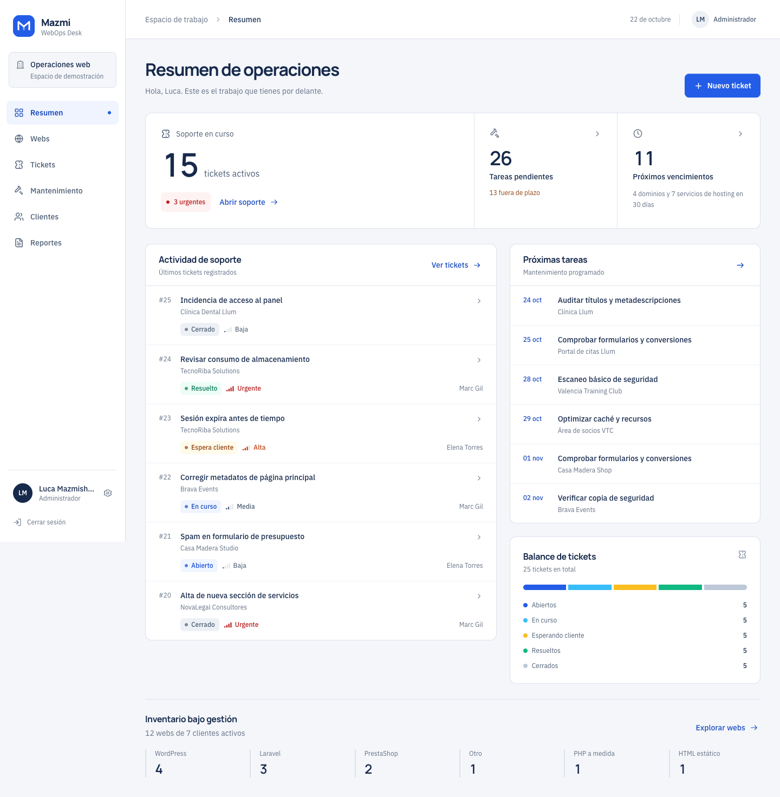

### Inventario y detalle de una web

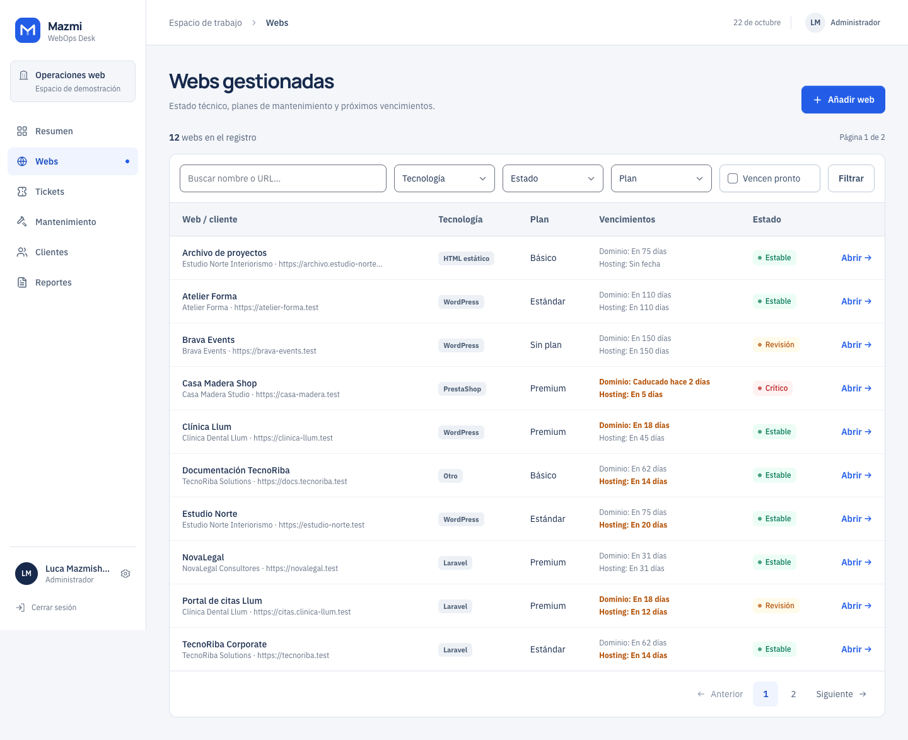

<details>
<summary>Ver la ficha técnica de una web</summary>

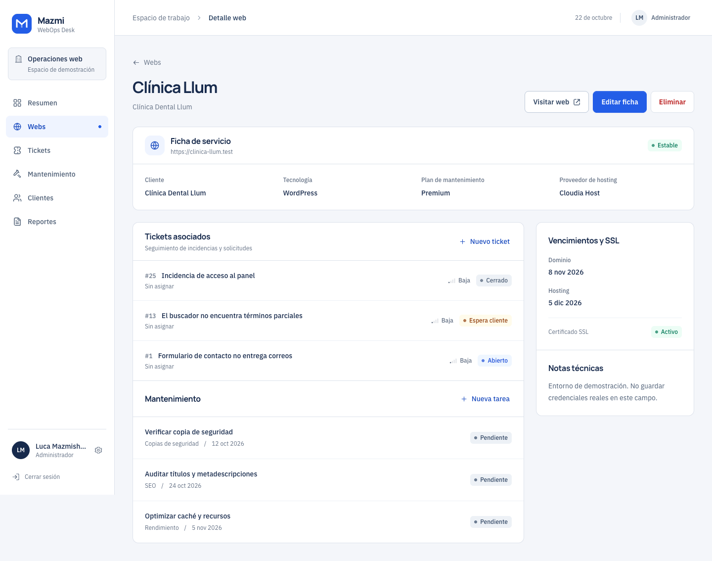

</details>

### Soporte y mantenimiento

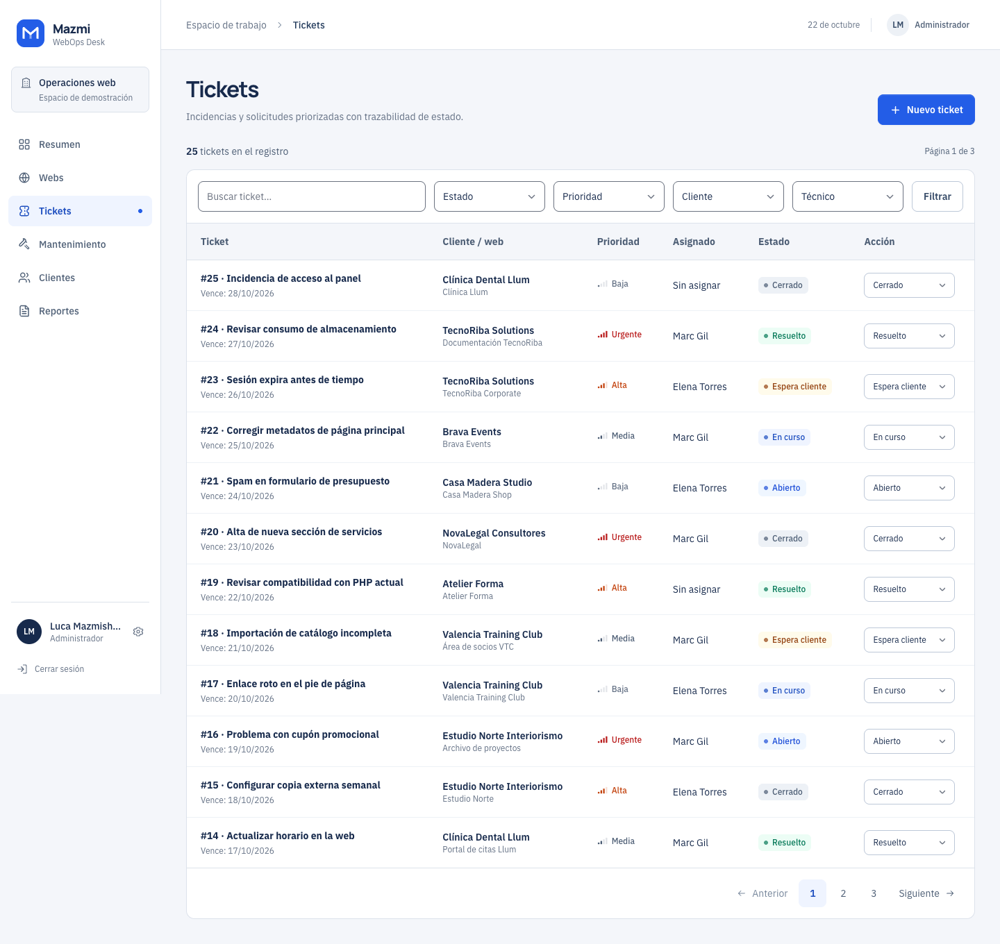

<details>
<summary>Ver las tareas de mantenimiento y sus filtros</summary>

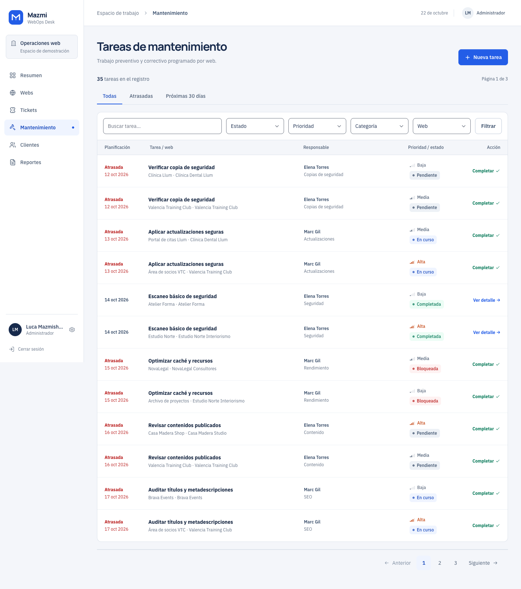

</details>

### Reporte mensual

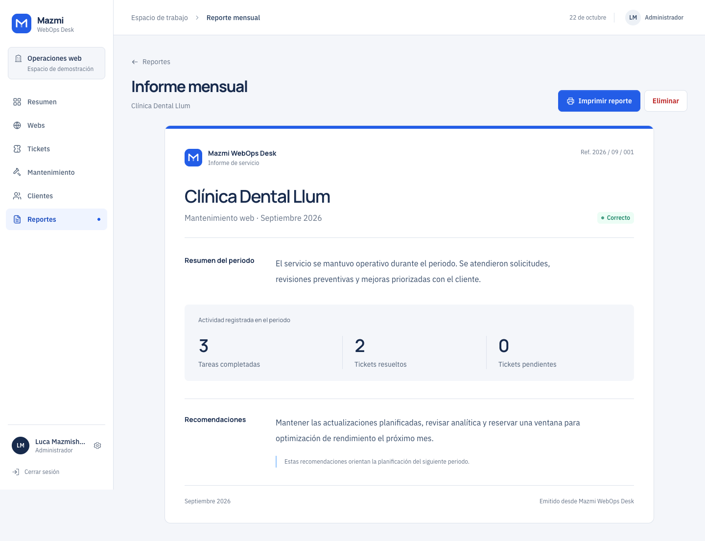

<details>
<summary>Ver clientes, presentación pública y acceso</summary>

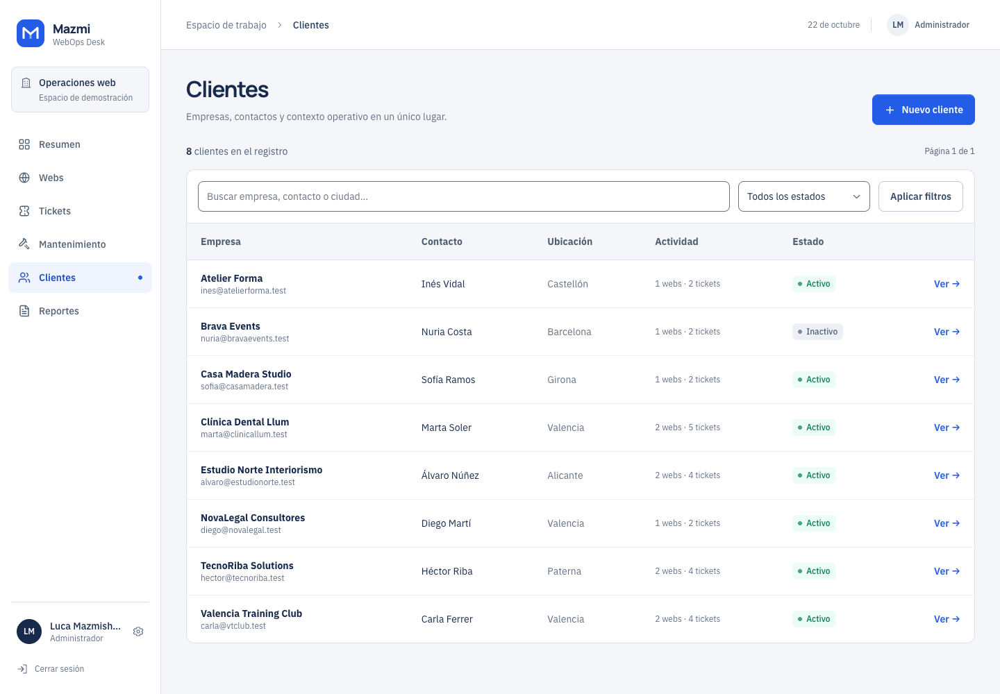

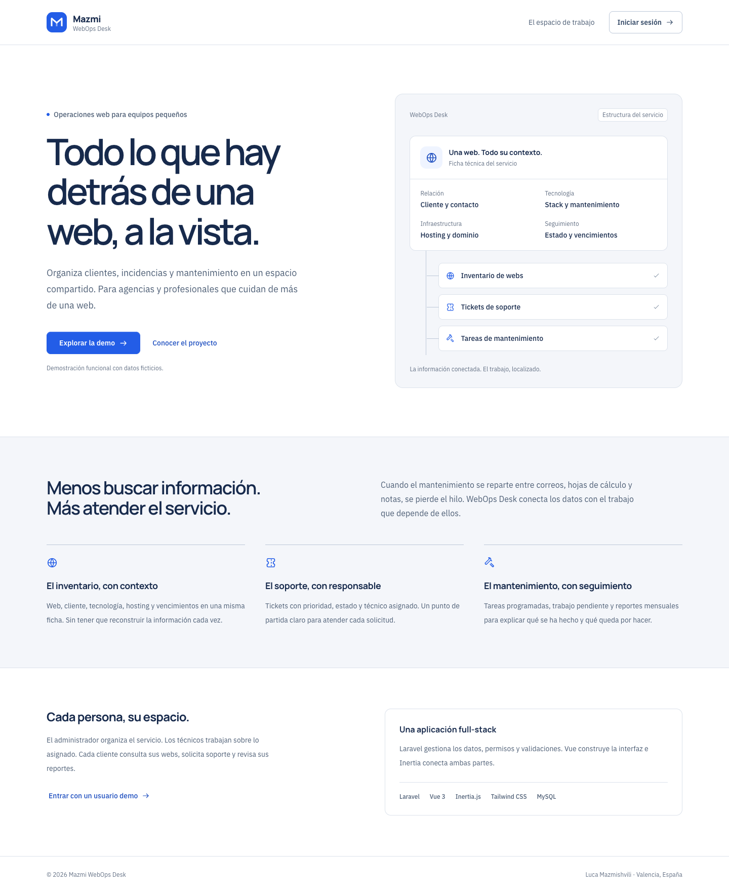

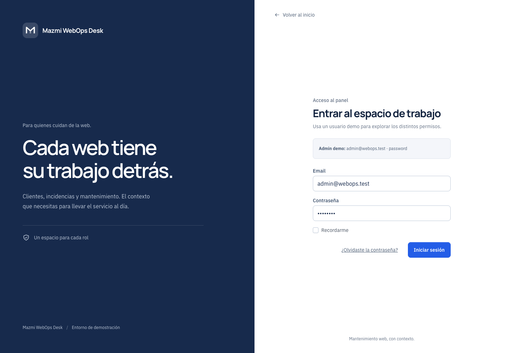

</details>

<details>
<summary>Ver la interfaz móvil</summary>

| Resumen | Tickets | Detalle web |
| --- | --- | --- |
| 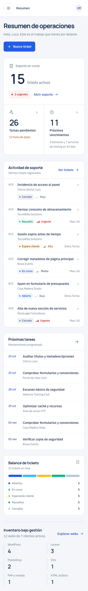 | 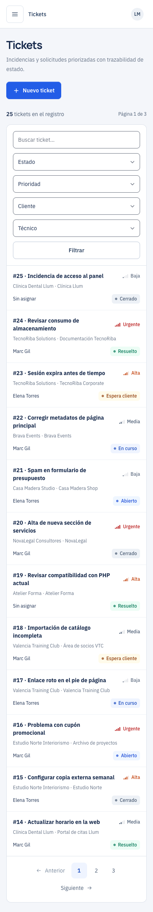 | 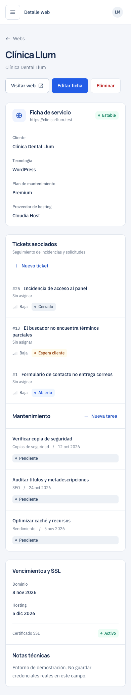 |

</details>

<a id="stack"></a>

## Stack técnico

| Área | Tecnología |
| --- | --- |
| Servidor | PHP 8.3+, Laravel 13 y Eloquent |
| Interfaz | Vue 3, JavaScript e Inertia.js 2 |
| Estilos y assets | Tailwind CSS 3 y Vite 8 |
| Datos | MySQL 8; SQLite para demo y tests |
| Autenticación | Laravel Breeze, sesiones y protección CSRF |
| Calidad | PHPUnit 12, Laravel Pint, Prettier y GitHub Actions |
| Tipografía | Manrope e IBM Plex Sans, autoalojadas con sus licencias OFL |

<a id="instalacion"></a>

## Instalación y ejecución

### Requisitos

- PHP 8.3+ y Composer 2, con las extensiones requeridas por Laravel y el controlador PDO de la base elegida.
- Node.js 20.19+ en la rama 20, o Node.js 22.12+; npm. CI utiliza Node 22.
- MySQL 8 o SQLite.

### 1. Preparar el proyecto

```bash
git clone https://github.com/LucaMZM/mazmi-webops-desk.git
cd mazmi-webops-desk
composer install
npm ci
cp .env.example .env
php artisan key:generate
```

### 2. Elegir la base de datos

**MySQL — opción principal**

Crea una base vacía:

```sql
CREATE DATABASE mazmi_webops_desk
  CHARACTER SET utf8mb4 COLLATE utf8mb4_unicode_ci;
```

Configura `.env` con las credenciales de tu servidor local:

```dotenv
DB_CONNECTION=mysql
DB_HOST=127.0.0.1
DB_PORT=3306
DB_DATABASE=mazmi_webops_desk
DB_USERNAME=root
DB_PASSWORD=
```

**SQLite — demo local**

Crea el archivo:

```bash
touch database/database.sqlite
```

Sustituye las variables de conexión y base de datos de `.env`:

```dotenv
DB_CONNECTION=sqlite
DB_DATABASE=database/database.sqlite
```

No conserves `DB_DATABASE=mazmi_webops_desk` al cambiar a SQLite. En Windows puedes crear un archivo vacío en esa misma ubicación desde el explorador o PowerShell.

### 3. Crear el esquema desde cero (sin datos ficticios)

Para una instalación limpia ejecuta **solo** `php artisan migrate`. El esquema se crea vacío: sin clientes, webs, tickets, tareas ni reportes de ejemplo. Registra después la primera cuenta autorizada con el flujo de alta existente. No ejecutes los seeders en tu instalación real.

```bash
php artisan migrate
```

Antes de iniciar sesión en una instalación vacía, crea tu primer administrador desde la terminal interactiva:

```bash
php artisan webops:admin
```

Introduce nombre, email y una contraseña única de al menos 12 caracteres (mayúsculas, minúsculas y números). La aplicación **no incluye credenciales por defecto**. Tras crear el primer usuario, este comando rechaza nuevas altas; los accesos futuros se administran por flujos autorizados.

**Solo en una base de pruebas desechable**, `php artisan migrate:fresh` elimina todas las tablas y datos y vuelve a crear el esquema. Haz una copia de seguridad y comprueba la conexión de `.env` antes de ejecutarlo. Este proyecto no borra datos de ninguna instancia automáticamente.

### 3b. Cargar datos de demostración (opcional, solo entorno de pruebas)

```bash
php artisan optimize:clear
php artisan db:seed --class=DemoSeeder
```

Ejecuta el seeder de demostración explícitamente sobre una base de pruebas vacía. Cargan 6 usuarios, 8 clientes, 12 webs, 25 tickets, 35 tareas y 6 reportes. Las fechas se calculan respecto al momento de la carga.

### 4. Abrir la aplicación

En una terminal:

```bash
php artisan serve
```

En otra:

```bash
npm run dev
```

Abre [http://127.0.0.1:8000](http://127.0.0.1:8000).

Para probar los assets compilados, ejecuta `npm run build` y mantén únicamente `php artisan serve`. Detén antes Vite si estaba abierto.

<a id="demo"></a>

## Usuarios demo

**Solo si has ejecutado `php artisan db:seed --class=DemoSeeder` en una base desechable:** contraseña común: `password`. Son cuentas de demostración; no deben utilizarse en un despliegue público sin adaptar el acceso.

| Rol | Email |
| --- | --- |
| Administrador | `admin@webops.test` |
| Técnico | `tech1@webops.test` |
| Técnico | `tech2@webops.test` |
| Cliente | `cliente1@webops.test` |
| Cliente | `cliente2@webops.test` |
| Cliente | `cliente3@webops.test` |

Los dominios `.test` y los contactos pertenecen al conjunto ficticio de datos. La aplicación no tiene campos para credenciales de las webs: no deben introducirse contraseñas ni tokens en notas o tickets.

<a id="calidad"></a>

## Calidad y CI

```bash
composer validate --strict
composer format:check
npm run format:check
composer test
npm run build
```

Las pruebas cubren helpers de roles, autenticación, autorización, aislamiento de clientes, validación y flujos CRUD. PHPUnit utiliza SQLite en memoria; Vite se desactiva en los tests del backend y su build se valida por separado.

[GitHub Actions](https://github.com/LucaMZM/mazmi-webops-desk/actions/workflows/ci.yml) instala las dependencias, prepara SQLite, ejecuta migraciones y seeders, comprueba Pint y Prettier, ejecuta los tests y compila el frontend.

Para aplicar formato: `composer format` y `npm run format`.

<a id="estructura"></a>

## Estructura y decisiones técnicas

```text
app/
  Http/Controllers/       Flujos de cada módulo
  Http/Requests/          Validación de entradas
  Models/                 Entidades y relaciones Eloquent
  Policies/               Autorización por recurso
database/
  migrations/             Esquema e integridad de datos
  seeders/                Escenario de demostración
resources/
  css/                    Tokens y estilos compartidos
  fonts/                  Fuentes locales y licencias
  js/
    Components/           Controles y componentes reutilizables
    Composables/          Comportamiento compartido de formularios
    Layouts/              Navegación y estructura de páginas
    Pages/                Vistas Inertia por módulo
docs/                     Documentación y capturas
tests/                    Pruebas unitarias y funcionales
```

Laravel concentra las reglas, la validación y la autorización en el servidor. Inertia permite navegar y enviar formularios con Vue conservando las rutas de Laravel, sin mantener una API REST adicional. El sistema visual comparte colores, tipografía y controles entre el panel, el acceso y la página pública.

`.env`, dependencias, SQLite local, logs, cachés y `public/build/` se excluyen de Git. El build se genera durante la instalación o en CI.

<a id="documentacion"></a>

## Documentación

- [Tablas, relaciones y reglas de integridad](docs/database-schema.md).
- [Comportamiento de los módulos y permisos](docs/features.md).

<a id="mejoras"></a>

## Próximas mejoras

- Exportación de reportes a PDF desde el servidor.
- Notificaciones por email y adjuntos en tickets.
- Calendario visual de mantenimiento.
- Pruebas de interfaz y accesibilidad integradas en CI.
- API REST y despliegue de una demo online controlada.

<a id="autor"></a>

## Autor y licencia

**Luca Mazmishvili** · Desarrollador web · Valencia, España.

Código original con **todos los derechos reservados** ([LICENSE](LICENSE)); únicamente para evaluación de portfolio. No se autoriza copiarlo, modificarlo, distribuirlo ni explotarlo sin permiso expreso. Las versiones anteriores publicadas bajo MIT conservan los permisos que ya les fueron concedidos. Las fuentes conservan sus licencias independientes en [resources/fonts](resources/fonts).
